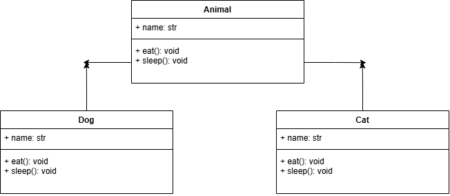

# Instruction: Do what is asked in each item below:
# 1. For each code example on single, multilevel, and hierarchical inheritance, create the
# corresponding class diagram in your notebook. Clearly identify the attributes and methods of
# each class. Show the correct inheritance relationship between classes.
# 2. Run the code examples in your IDE. Modify the code by adding getter and setter methods,
# changing object values, adding new objects, and adjusting method outputs. Observe how
# these changes affect the program. Experiment freely to strengthen your understanding of
# inheritance.

#CODE EXAMPLE 1
# Create the parent class
class Animal:
    def __init__(self, name):
     self.name = name

    def eat(self):
        print(self.name, "is eating.")

    def sleep(self):
        print(self.name, "is sleeping.")

# Create the child classes without attributes and methods
class Dog(Animal):
    pass # No new methods

class Cat(Animal):
    pass # No new methods

# Create the objects
animal1 = Animal("Generic Animal")
dog1 = Dog("Bruno")
cat1 = Cat("Kitty")

# Use the parent's methods on each object
animal1.eat() # Generic Animal is eating.
animal1.sleep() # Generic Animal is sleeping.
dog1.eat() # Bruno is eating.
dog1.sleep() # Bruno is sleeping.
cat1.eat() # Kitty is eating.
cat1.sleep() # Kitty is sleeping.

#CODE EXAMPLE 2
class Person:
    def __init__(self, name, age):
    self.name = name
    self.age = age

class Employee(Person):
    def __init__(self, name, age, job_title, salary):
        super().__init__(name , age)
        self.job_title = job_title
        self.salary = salary

class Manager(Employee):

    def __init__(self, name, age, job_title, salary, department):
        super().__init__(name, age, job_title, salary)
        self.department = department

manager = Manager("Alice", 35, "Project Manager", 80000, "IT")
print(manager.name)
print(manager.age)
print(manager.job_title)
print(manager.salary)
print(manager.department)

#CLASS DIAGRAMS: , 

